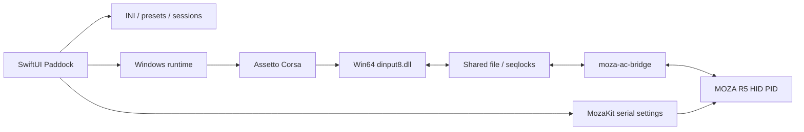

# Архитектура

## Границы

`Paddock/App` собирает приложение, `Views` отображает состояние, `Models` содержит конфигурации и идентичность заезда. `Services` сканирует контент, пишет INI, сохраняет историю и запускает процессы. `Diagnostics` проверяет их на временных фикстурах.

`MozaKit` владеет протоколом serial, HID-вводом и HID PID-эффектами. UI не посылает произвольные отчёты. `MozaACBridge` переносит состояние руля в shared file и силу игры в MozaKit. DLL предоставляет виртуальный DirectInput R5 игре; остальные устройства передаются Wine.

`Bridge/display-launcher.c` выбирает внешний монитор, создаёт процесс игры приостановленным и подписывается на события создания/показа его окон перед возобновлением. Ранние окна переносятся на выбранный монитор; главное окно разворачивается без рамок, диалоги сохраняют свой размер. Подписка ограничена PID игры. Эксклюзивный fullscreen Wine может выбирать основной экран, поэтому используется borderless.

## Обмен и жизненный цикл

8192-байтный файл в `/tmp/moza-ac-<uid>/ffb-v2.bin`: ввод offset64, сила256, эффекты320, physics4096, graphics6144. Обмен защищён последовательностями seqlock. Graphics содержит время, Windows PID и исходный блок AC. Сила истекает при потере свежих данных; включение плавное.

Контекст сессии — снимок настроек при запуске, не текущий редактируемый черновик. Рекорд привязан к SHA-256 конфигурации. PID и свежесть данных защищают от чужой сессии. Подтверждённый лучший круг берётся из `iBestTime` игры; валидность остальных кругов не выдумывается.

## Хранение

JSON в Application Support записывается атомарно. Ошибка чтения блокирует перезапись повреждённого файла. INI игры лежат в Documents. Установщик модов сначала проверяет архив, затем создаёт план и резервные копии, откатывает неудачную установку; ссылки и выход за корень запрещены.

## Среда Windows

`LaunchRuntime` выбирает CrossOver или независимый Wine. `WineProcess` строит аргументы Python CLI без shell-интерполяции. `Scripts/paddock-runtime.py` — общая граница SwiftUI и shell-лаунчера. `Scripts/runtime/managed.py` устанавливает закреплённые зависимости и готовит prefix; `manifest.json` хранит версии, SHA-256 и ссылки на лицензии.

Независимый Wine имеет собственные бинарные файлы и prefix; миграция переносит только Steam/игровые файлы пользователя, а не системные DLL CrossOver. Выбор среды не меняет пресеты, протокол руля или формат рекордов. Пустая новая библиотека не сбрасывает сохранённый выбор машины и трассы. Подробности — [standalone-runtime](standalone-runtime.md).

## Совместимость интерфейса Steam

`runtime/steam_cef.py` устанавливает собственный WinMM-прокси из `Bridge/steam-cef.c` только в независимую среду. Он перенаправляет исходные функции WinMM и изменяет импорт командной строки только в браузерном процессе CEF. Это позволяет применить `--in-process-gpu`, который Steam не передаёт из обычных параметров. Системный код WinAPI и файлы Valve не изменяются. Подробности и проверки — в [standalone-runtime](standalone-runtime.md).

`runtime/directx.py` устанавливает игровые prerequisite DLL из Steam-provided Microsoft CABs с проверкой отдельных CAB/DLL SHA-256 и x64 PE. DLL лежат в игровой папке; overrides ограничены `acs.exe`, прежние версии сохраняются в Backups. `runtime/logfiles.py` компактирует только закрытый журнал запуска после заезда.

## Зависимости модов

`paddock-mods.py` устанавливает машины и трассы транзакционно. Из того же корня архива он также распознаёт `content/fonts` и комплектные `apps/lua` с манифестом и Lua-файлом. Общие шрифты заменяются пофайлово; резервные копии и откат сохраняют соседний контент. Отдельные приложения без машины/трассы не устанавливаются.

`runtime/csp.py` отдельно проверяет SHA-256 официального CSP и x64 PE, сохраняет прежний `extension`/`dwrite.dll` и ограничивает DLL override процессом `acs.exe`. Наличие CSP не означает проверенную совместимость конкретного мода с Wine.
