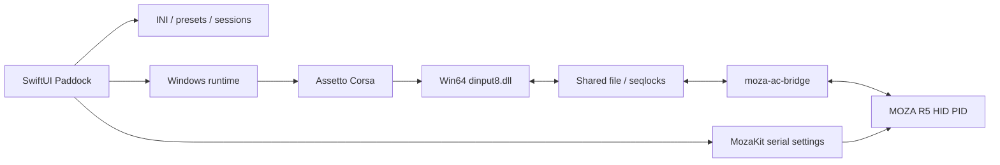

# Архитектура

## Границы

`Paddock/App` собирает приложение, `Views` отображает состояние, `Models` содержит конфигурации и идентичность заезда. `Services` сканирует контент, пишет INI, сохраняет историю и запускает процессы. `Diagnostics` проверяет их на временных фикстурах.

`MozaKit` владеет протоколом serial, HID-вводом и HID PID-эффектами. UI не посылает произвольные отчёты. `MozaACBridge` переносит состояние руля в shared file и силу игры в MozaKit. DLL предоставляет виртуальный DirectInput R5 игре; остальные устройства передаются Wine.

`Bridge/display-launcher.c` создаёт игру скрытой, выбирает внешний монитор и разворачивает отдельное окно без рамок. Эксклюзивный fullscreen Wine может выбирать основной экран, поэтому используется borderless.

## Обмен и жизненный цикл

8192-байтный файл в `/tmp/moza-ac-<uid>/ffb-v2.bin`: ввод offset64, сила256, эффекты320, physics4096, graphics6144. Обмен защищён последовательностями seqlock. Graphics содержит время, Windows PID и исходный блок AC. Сила истекает при потере свежих данных; включение плавное.

Контекст сессии — снимок настроек при запуске, не текущий редактируемый черновик. Рекорд привязан к SHA-256 конфигурации. PID и свежесть данных защищают от чужой сессии. Подтверждённый лучший круг берётся из `iBestTime` игры; валидность остальных кругов не выдумывается.

## Хранение

JSON в Application Support записывается атомарно. Ошибка чтения блокирует перезапись повреждённого файла. INI игры лежат в Documents. Установщик модов сначала проверяет архив, затем создаёт план и резервные копии, откатывает неудачную установку; ссылки и выход за корень запрещены.

## Среда Windows

`LaunchRuntime` выбирает CrossOver или независимый Wine. `WineProcess` строит аргументы Python CLI без shell-интерполяции. `Scripts/paddock-runtime.py` — общая граница SwiftUI и shell-лаунчера. `Scripts/runtime/managed.py` устанавливает закреплённые зависимости и готовит prefix; `manifest.json` хранит версии, SHA-256 и ссылки на лицензии.

Независимый Wine имеет собственные бинарные файлы и prefix; миграция переносит только Steam/игровые файлы пользователя, а не системные DLL CrossOver. Выбор среды не меняет пресеты, протокол руля или формат рекордов. Пустая новая библиотека не сбрасывает сохранённый выбор машины и трассы. Подробности — [standalone-runtime](standalone-runtime.md).

## Совместимость интерфейса Steam

`runtime/steam_cef.py` устанавливает собственный WinMM-прокси из `Bridge/steam-cef.c` только в независимую среду. Он перенаправляет исходные функции WinMM и изменяет импорт командной строки только в браузерном процессе CEF. Это позволяет применить `--in-process-gpu`, который Steam не передаёт из обычных параметров. Системный код WinAPI и файлы Valve не изменяются. Подробности и проверки — в [standalone-runtime](standalone-runtime.md).

`runtime/directx.py` устанавливает игровые prerequisite DLL из Steam-provided Microsoft CABs с проверкой отдельных CAB/DLL SHA-256 и x64 PE. DLL лежат в игровой папке; overrides ограничены `acs.exe`, прежние версии сохраняются в Backups. `runtime/logfiles.py` компактирует только закрытый журнал запуска после заезда.

`runtime/session.py` завершает Steam с `-shutdown`, затем закрывает wineserver только с явным WINEPREFIX выбранного сеанса. Вызов Steam пропускается, если его процесс не использует этот prefix. Ожидание ограничено; новый заезд в Paddock блокируется до завершения предыдущего launcher.

## Настройки руля

`MozaKit/WheelInputSettings.swift` содержит преобразование оси и конфигурацию кнопочных команд. Paddock сохраняет её вместе с пресетом и пишет `bridge-controls.json`; нативный мост читает файл при запуске. Линейность, мёртвая зона, насыщение и сглаживание применяются до DirectInput, без повторной гаммы в игре. Кнопка сцепления формирует отдельную ось Slider0; автосцепление отключается при таком назначении. Аппаратный угол и `STEER/LOCK` совпадают, а «Руль 1:1» сбрасывает нелинейные преобразования рулевой оси.

Новые настройки опциональны в старых JSON: отсутствие поля сохраняет прежний fingerprint рекордов. Для отдельного Metal-профиля синхронизируются controls/assists, без замены его графических настроек. Пит-лимитер, дворники и команды RSS записываются под именами из манифеста установленного CSP и помечаются в UI. Поддержка конкретных команд зависит от машины.

## Онлайн

`OnlineBrowser` и `OnlineView` отвечают за поиск, постраничный каталог, проверку выбранного сервера и выбор машины. `Scripts/online/servers.py` изолирует сетевые операции и декодирование публичных форматов от нативного интерфейса. `OnlineConnection` содержит только временные параметры, записывает REMOTE после обычной подготовки Steam и очищает секреты при завершении. Общий launcher обслуживает и локальные, и онлайн-заезды. Необязательное поле `SessionContext.onlineServer` совместимо со старой историей и исключает онлайн-времена из локальных рекордов пресетов. Подробности и ограничения: [online.md](online.md).

Перед запуском acs.exe оконный helper проверяет готовность настоящей `SteamAPI_Init` из `steam_api64.dll` установленной игры (до 30 секунд), затем вызывает `SteamAPI_Shutdown`. Реестровый ActiveUser сам по себе не подтверждает готовность IPC после холодного старта клиента. DLL Steam не входит в репозиторий и не заменяется. См. [документацию Valve](https://partner.steamgames.com/doc/api/steam_api#SteamAPI_Init).

Мост передаёт кнопки 1–40: первые 25 остаются в прежнем слове, 26–40 — в 15-битном расширении со сверкой sequence/timestamp. Новый reader принимает MB34 и MB40; publisher сохраняет MB34, пока не нажата кнопка 35–40, затем использует MB40. Прежний reader при MB40 сохраняет первые 25 кнопок, а новый принимает весь диапазон. DirectInput сообщает 40 кнопок. Проверки включают 35, 36, 40 и подавление устаревших расширенных данных.
