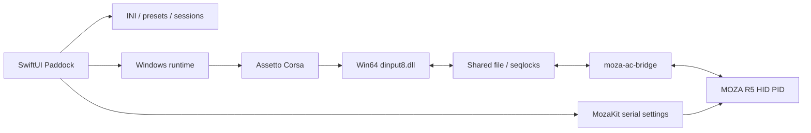

# Архитектура

## Границы

`Paddock/App` собирает приложение, `Views` отображает состояние, `Models` содержит конфигурации и идентичность заезда. `Services` сканирует контент, пишет INI, сохраняет историю и запускает процессы. `Diagnostics` проверяет их на временных фикстурах.

`MozaKit` владеет протоколом serial, HID-вводом и HID PID-эффектами. UI не посылает произвольные отчёты. `MozaACBridge` переносит состояние руля в shared file и силу игры в MozaKit. DLL предоставляет виртуальный DirectInput R5 игре; остальные устройства передаются Wine.

`Bridge/display-launcher.c` создаёт игру скрытой, выбирает внешний монитор и разворачивает отдельное окно без рамок. Эксклюзивный fullscreen Wine может выбирать основной экран, поэтому используется borderless.

## Обмен и жизненный цикл

8192-байтный файл в `/tmp/moza-ac-<uid>/ffb-v2.bin`: ввод offset64, сила256, эффекты320, physics4096, graphics6144. Обмен защищён последовательностями seqlock. Graphics содержит время, Windows PID и исходный блок AC. Сила истекает при потере свежих данных; включение плавное.

Контекст сессии — снимок настроек при запуске, не текущий редактируемый черновик. Рекорд привязан к SHA-256 конфигурации. PID и свежесть данных защищают от чужой сессии. Подтверждённый лучший круг берётся из `iBestTime` игры; валидность остальных кругов не выдумывается.

## Хранение

JSON в Application Support записывается атомарно. Ошибка чтения блокирует перезапись повреждённого файла. INI игры лежат в Documents. Установщик модов сначала проверяет архив, затем создаёт план и резервные копии, откатывает неудачную установку; ссылки и выход за корень запрещены.

## Среда Windows

CrossOver — исходный провайдер. Независимый Wine должен иметь собственные бинарные файлы и prefix; миграция переносит только Steam/игровые файлы пользователя, а не системные DLL CrossOver. Выбор среды не должен менять пресеты, протокол руля или формат рекордов.
